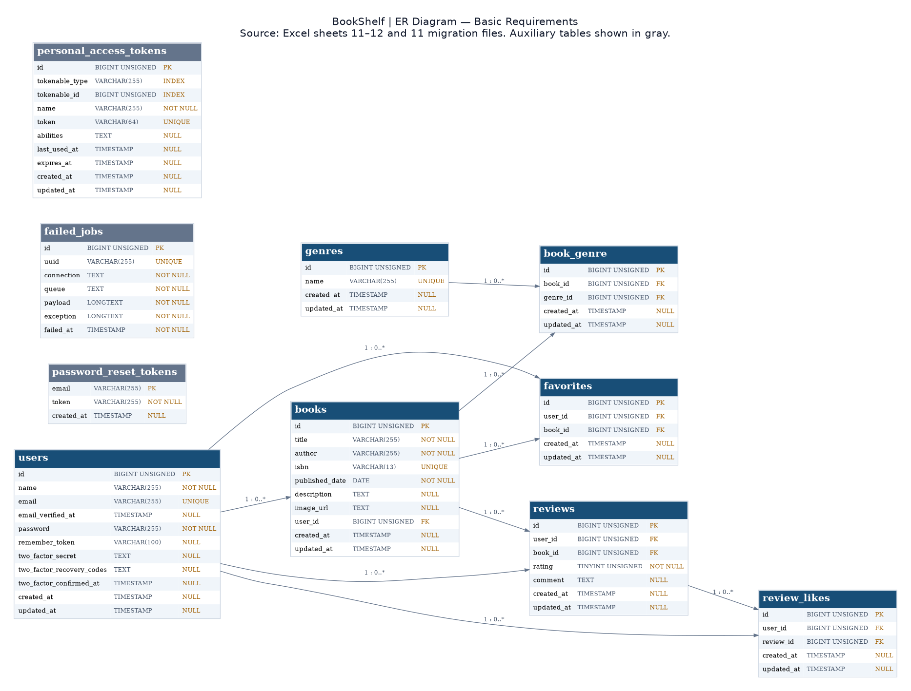

# BookShelf 書籍レビューアプリ

## 1. プロジェクト概要

BookShelfは、書籍情報の登録・管理、レビュー投稿、評価、お気に入り登録などを行う書籍レビューアプリケーションです。

Laravel 10を使用したTraditional Webアプリケーションとして構築し、Bladeテンプレートによる画面表示とセッション認証を採用しています。

また、外部アプリケーションから書籍情報を操作できるJSON形式の公開APIも提供しています。

### 主な機能

- ユーザー登録・ログイン・ログアウト
- 書籍の一覧表示・詳細表示・登録・編集・削除
- 書籍のキーワード検索・ジャンル検索
- ジャンル管理
- 書籍レビューの投稿・編集・削除
- 書籍の評価と平均評価の表示
- お気に入り登録・解除
- レビューへのいいね・解除
- 書籍ランキングの表示
- 書籍情報の公開API（CRUD）
- 初期データのシーディング

## 2. ER図

本アプリケーションのデータベース構造を以下に示します。



ER図の関連ファイル：

- [ER図（SVG形式）](docs/BookShelf_ER図_基本要件.svg)
- [ER図（Mermaid記法）](docs/BookShelf_ER図_基本要件.md)

主なテーブルは以下のとおりです。

- `users`：ユーザー情報
- `books`：書籍情報
- `genres`：ジャンル情報
- `book_genre`：書籍とジャンルの関連情報
- `reviews`：レビュー情報
- `favorites`：お気に入り情報
- `review_likes`：レビューへのいいね情報

その他、Laravelの認証・トークン管理などに関連するテーブルを使用します。

## 3. 環境構築手順

### 3.1 必要な環境

- Docker Desktop
- Docker Compose
- Git
- Laravel Sailを実行できる環境

本プロジェクトでは、Laravel Sailを使用してPHP・MySQLなどの実行環境をコンテナ化しています。

### 3.2 プロジェクトの準備

取得したプロジェクトのディレクトリに移動します。

```bash
cd bookshelf-app
```

依存パッケージがまだインストールされていない場合は、以下のコマンドでComposerの依存関係をインストールします。

```bash
docker run --rm -u "$(id -u):$(id -g)" -v "$(pwd):/var/www/html" -w /var/www/html -e COMPOSER_CACHE_DIR=/tmp/composer_cache laravelsail/php82-composer:latest composer install
```

このDockerイメージは初期セットアップ用です。アプリケーションの実行にはPHP 8.5のSail環境を使用します。

### 3.3 環境変数の設定

`.env.example` をコピーして `.env` を作成します。

```bash
cp .env.example .env
```

`.env` のデータベース設定を以下のようにします。

```dotenv
APP_NAME=BookShelf
APP_URL=http://localhost

DB_CONNECTION=mysql
DB_HOST=mysql
DB_PORT=3306
DB_DATABASE=laravel
DB_USERNAME=sail
DB_PASSWORD=password
```

`DB_HOST` には、`localhost` や `127.0.0.1` ではなく、Docker ComposeのMySQLサービス名である `mysql` を指定します。

実際のDocker Compose設定と接続情報が一致していることを確認してください。

### 3.4 Laravel Sailの起動

```bash
./vendor/bin/sail up -d
```

コンテナの起動が完了するまで待ちます。

### 3.5 アプリケーションキーの生成

```bash
./vendor/bin/sail artisan key:generate
```

### 3.6 フロントエンドのセットアップ

Node.js関連の依存パッケージをインストールします。

```bash
./vendor/bin/sail npm install
```

本プロジェクトでは、Vite、Tailwind CSS、Alpine.js、`@tailwindcss/forms` を使用します。

開発用のフロントエンドサーバーを起動します。

```bash
./vendor/bin/sail npm run dev
```

このコマンドは開発中、起動したままにします。

本番用アセットを生成する場合は、代わりに以下を実行できます。

```bash
./vendor/bin/sail npm run build
```

### 3.7 データベースのマイグレーションと初期データ投入

新規に構築したデータベースに対して、以下を実行します。

```bash
./vendor/bin/sail artisan migrate --seed
```

マイグレーションによるテーブル作成と、Seederによる初期データ投入を行います。

既存のデータベースに対しては、データの重複や整合性を確認してから実行してください。

**注意：** `migrate:fresh --seed` は既存テーブルを削除して再作成するため、データを保持する必要がある環境では実行しないでください。

### 3.8 日本語メッセージ

バリデーションおよび認証メッセージは日本語で表示する構成です。

Laravelのロケール設定と、`lang/ja/` 配下の日本語メッセージファイルを使用します。

### 3.9 アプリケーションへのアクセス

ブラウザで以下にアクセスします。

http://localhost

書籍一覧：

http://localhost/books

phpMyAdmin：

http://localhost:8080

phpMyAdminのポート番号はDocker Composeの設定によって変更される場合があります。

## 4. 使用技術

| 分類 | 技術 |
| --- | --- |
| バックエンド | PHP 8.5 |
| フレームワーク | Laravel 10 |
| データベース | MySQL 8.4 |
| テンプレート | Blade |
| CSS | Tailwind CSS 3.4 |
| JavaScript | Alpine.js |
| ビルドツール | Vite |
| 認証 | Laravel Fortify |
| API関連 | Laravel API Resource、Laravel Sanctum |
| 開発環境 | Docker、Docker Compose、Laravel Sail |
| DB管理 | phpMyAdmin |
| テスト | PHPUnit |
| コード整形 | Laravel Pint |
| バージョン管理 | Git |

Laravel Sanctumは導入されていますが、基本要件の書籍公開APIは認証なしで利用できる構成です。

## 5. 応用機能

### 書籍の詳細検索・並び替え

書籍一覧では、書籍名・著者名によるキーワード検索、ジャンルによる絞り込み、並び替えを利用できます。検索条件はページ移動時にも引き継がれます。

### ISBNによる書籍情報検索

ログインユーザーはISBNを指定し、Google Books APIから書籍情報を検索できます。取得できた情報を新規書籍登録時の入力補助として使用します。外部APIの応答内容や通信状況に応じたエラー処理を実装しています。

### 読書プラン管理

ログインユーザーは、書籍ごとに読書プランを登録し、目標日を設定できます。プランの一覧表示、状態による絞り込み、目標日の変更、読了処理、完了済みプランの削除などに対応しています。

### 読書期限の通知

読書プランの目標日の3日前、当日、3日後にアプリ内通知を生成します。期限を過ぎた進行中プランは期限切れ状態へ変更されます。同一プラン・同一タイミングで通知が重複しないようにしています。

通知コマンド：

`./vendor/bin/sail artisan reading-plans:send-deadline-notifications`

Laravelのスケジューラーには、日本時間の毎日20:00に実行する設定があります。

ただし、定期的な自動実行には、実行環境からLaravelスケジューラーを起動する仕組みが別途必要です。スケジュール設定だけでは自動実行は保証されません。

### マイ読書レポート

ログインユーザー自身のレビューを対象に、レビュー総数、レビュー済み書籍数、平均評価、評価分布、評価の高い書籍上位5件、ジャンル別の上位5件を表示します。

削除済みレビューは集計対象に含めません。

### 応用機能で追加したデータベース構造

基本要件のER図は `docs/BookShelf_ER図_基本要件.png` に掲載しています。

応用機能では、読書プランを管理する `reading_plans` テーブルと、アプリ内通知を管理する `notifications` テーブルを追加しています。これらは基本要件ER図には含まれていません。

データベースの正確な定義は `database/migrations/` 配下のマイグレーションを参照してください。

### テスト

PHPUnitによるUnitテスト・Featureテストを実装しています。

2026年11月23日時点の全体テスト結果は、188件実行、186件成功、非推奨警告付き2件、失敗0件、613アサーションです。

PHP 8.5では `PDO::MYSQL_ATTR_SSL_CA` に関する非推奨警告が出力されます。

テスト実行コマンド：

`./vendor/bin/sail artisan test`

---

## 6. 作成者

小野寺 秀斗

## 7. APIエンドポイント一覧

書籍情報を操作するJSON形式の公開APIを提供します。

ベースパス：

`/api/v1`

| HTTPメソッド | エンドポイント | 概要 | 認証 |
| --- | --- | --- | --- |
| GET | `/api/v1/books` | 書籍一覧取得・検索 | 不要 |
| GET | `/api/v1/books/{book}` | 書籍詳細取得 | 不要 |
| POST | `/api/v1/books` | 書籍新規登録 | 不要 |
| PUT | `/api/v1/books/{book}` | 書籍更新 | 不要 |
| DELETE | `/api/v1/books/{book}` | 書籍削除 | 不要 |

### APIの主な仕様

- 書籍一覧APIはキーワード検索、ジャンル絞り込み、ページネーションに対応します。
- 書籍一覧にはジャンル情報、平均評価、レビュー件数を含めます。
- 書籍詳細にはジャンル情報とレビュー情報を含めます。
- API Resourceを使用してJSONレスポンスを整形します。
- 登録・更新時にはバリデーションを実施します。
- 存在しない書籍IDを指定した場合はエラーレスポンスを返します。

### 書籍一覧APIの検索パラメータ

`GET /api/v1/books` では、以下のクエリパラメータを指定できます。

| パラメータ | 説明 |
| --- | --- |
| `keyword` | 書籍名・著者名を部分一致検索。最大255文字 |
| `genre_id` | 存在するジャンルIDで絞り込み |
| `page` | 取得ページ番号。1以上の整数 |
| `per_page` | 1ページ当たりの取得件数。1～100の整数。省略時は20件 |

検索条件は組み合わせて指定できます。

リクエスト例：

`GET /api/v1/books?keyword=Laravel&genre_id=1&page=1&per_page=20`

※ `genre_id=1` は指定例です。実際に存在するジャンルIDを指定してください。

## 8. 開発環境URL

| 用途 | URL |
| --- | --- |
| アプリケーション | http://localhost |
| 書籍一覧 | http://localhost/books |
| 公開API | http://localhost/api/v1/books |
| phpMyAdmin | http://localhost:8080 |

※URLおよびポート番号は、ローカル環境のDocker Compose設定に依存します。
