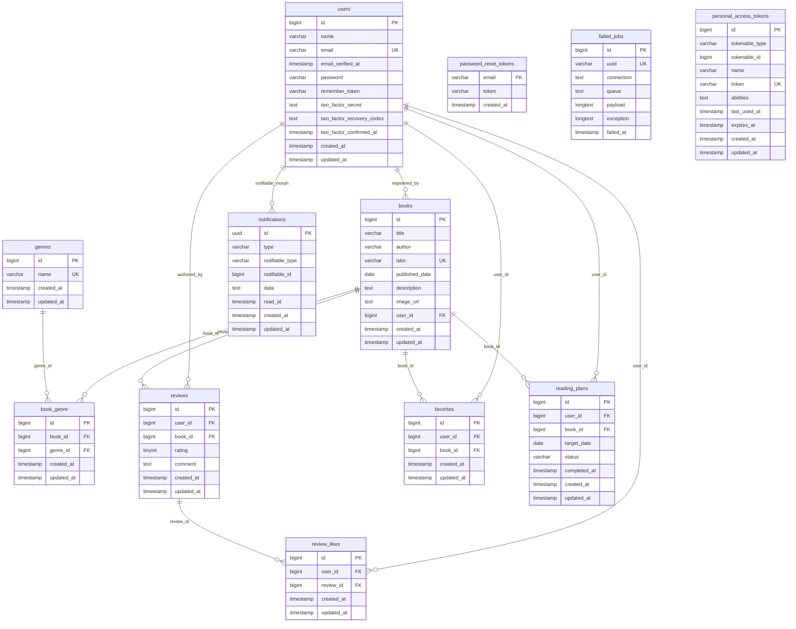

# BookShelf ER図（基本要件＋応用要件 統合版）

2026年11月23日時点のマイグレーションに基づく。

## 制約と注記

- `book_genre`: UNIQUE (`book_id`, `genre_id`)
- `favorites`: UNIQUE (`user_id`, `book_id`)
- `review_likes`: UNIQUE (`user_id`, `review_id`)
- `users.email`, `books.isbn`, `genres.name`, `failed_jobs.uuid`, `personal_access_tokens.token`: UNIQUE
- `books.user_id`, `reviews.user_id`, `reviews.book_id`, `book_genre.book_id`, `book_genre.genre_id`, `favorites.user_id`, `favorites.book_id`, `review_likes.user_id`, `review_likes.review_id`: 外部キー（ON DELETE CASCADE）
- `personal_access_tokens.tokenable_type` と `tokenable_id` はポリモーフィック関連用で、通常の外部キー制約ではありません。
- `password_reset_tokens.email` は主キーですが、`users.email` への外部キー制約はありません。
- Mermaid図の多重度はDB上の許容関係です。各子レコードは親1件を参照し、親には子レコード0件以上が関連します。
- NULL可否と正確なデータ型はマイグレーションを正本とし、上のMermaidには簡潔に表示しています。
- `books.isbn` と `books.published_date` は NULL 許容です。
- `reading_plans.status` は VARCHAR(20)、既定値は `in_progress` です。
- `reading_plans.completed_at` は NULL 許容です。
- `reading_plans` のインデックスは (`user_id`, `status`)、(`status`, `target_date`)、(`user_id`, `book_id`, `status`) です。
- `reading_plans.user_id` と `reading_plans.book_id` は外部キー（ON DELETE CASCADE）です。
- `notifications.notifiable_type` と `notifications.notifiable_id` はポリモーフィック関連用で、通常の外部キー制約ではありません。図中の `users` との関連線はアプリケーション上の関連を示します。
- `reviews.comment` はDB上NULL許容ですが、レビュー登録・更新時の入力検証では必須です。
